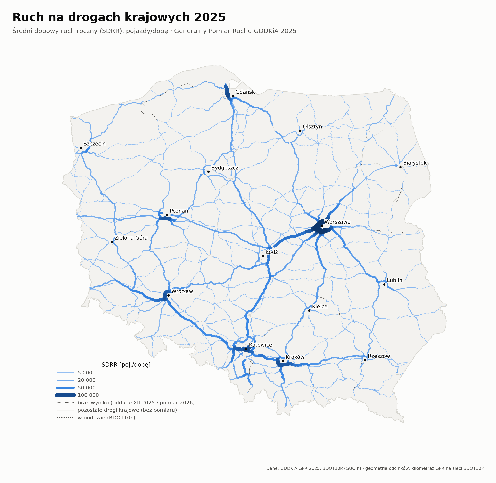

# Polish national-road traffic map & network (GPR 2025)

A flow map of traffic on Poland's national roads (drogi krajowe): **line width ∝ SDRR**
(average annual daily traffic) from GDDKiA's *Generalny Pomiar Ruchu 2025*. It also builds
a **node/link network** with counts attached, ready to seed a national traffic model.

## Status

_Updated 2026-11-24_

- Pipeline rebuilt **section-first**: every GPR section is placed on the BDOT10k road graph
  by its own chainage (km). The old approach (`legacy/`) cut the network first and gave
  each piece the nearest counting point's value. In that version **369 sections (≈2,100 km)
  never showed their own value**: they took their neighbour's.
- **2,422 / 2,424 sections placed (18,353 km)**; the 2 missing are roads BDOT10k still marks as
  under construction (S1h Brzeszcze–Stara Wieś opened Dec 2025; S74n Opatów, 2026 count).
  97% of km have a geometry length within
  ±20–25% of the official GPR section length; median ratio 0.999.
- Roads that were not in operation in 2025:
  - BDOT10k roads with `KAT_ISTNIE ≠ eksploatowany` (under construction) are never used
    for placement and are drawn dashed.
  - GPR sections without counts carry `status`: `opened_after_count` (opened Dec 2025),
    `pending_2026` (supplementary count in 2026), `not_counted`.
  - National roads with no GPR section (stretches managed by cities, old alignments)
    appear as grey context and as `counted = false` links in the model network.
- Model network: 3,134 nodes, 3,807 links (3,195 counted, 612 uncounted ≈1,900 km),
  98.7% of nodes in one connected component.
- BDOT10k re-extracted 2026-11-24 with all attributes (92,636 features, 739 under construction).
  Mazowieckie ships its layer in two parts (`*_SKDR_L.shp` + `*_SKDR_L_1.shp`); step 00 reads both.
- See `output/qa_report.md` for current metrics and `output/qa_sections_to_review.csv`
  for flagged sections.

## Outputs (`output/`)

| file | what |
|---|---|
| `traffic_network_2025.gpkg` | **main product** (EPSG:2180). It has QGIS default styles embedded, so drag it into QGIS |
| ├ `sections` | one line per GPR section: SDRR, vehicle classes, heavy share, status, QA |
| ├ `links`, `nodes` | modelling topology (sections split at junctions + uncounted connectors) |
| ├ `counting_points` | GPR counting stations |
| ├ `skdr_unmeasured` | operational national roads not covered by a section |
| └ `skdr_not_operational` | BDOT10k national roads under construction |
| `links_2025.csv`, `nodes_2025.csv` | the same topology as plain tables (from/to node, SDRR, km) |
| `cartogram_2025_light.png` / `_dark.png` | rendered flow map |
| `gpr2025_sections.csv`, `gpr2025_pieces.csv` | parsed GPR tables (sections; per-chainage-system pieces) |
| `qa_report.md`, `qa_sections_to_review.csv` | quality metrics |

## Pipeline (`pipeline/`)

Run everything: `.venv\Scripts\python.exe pipeline\run_all.py` (about 2 min).
Add `--extract` to re-extract BDOT10k first (about 1 h; only after a new BDOT download).

| step | does |
|---|---|
| `00_extract_bdot.py` | national roads (`OT_SKDR_L`, `KAT_ZARZAD=krajowa`) from `Polska_SHP.zip`, all attributes, full resolution → `data/bdot/skdr_krajowe.gpkg` |
| `01_parse_gpr.py` | GPR Tab01+Tab02 → sections + **pieces** (one per chainage system), status from remarks |
| `02_build_graph.py` | BDOT10k lines → routable graph (operational only, healed between voivodeship sheets) |
| `03_locate_sections.py` | **linear referencing** of sections (see below) |
| `04_build_network.py` | nodes/links: cluster section ends, split at T-junctions and at-grade crossings, add uncounted connectors |
| `05_qa_report.py` | metrics → `qa_report.md` |
| `06_render_cartogram.py` | PNG maps (light/dark) |
| `07_style_qgis.py` | `.qml` styles in `qgis/` and default styles embedded in the GeoPackage |

Shared settings: `pipeline/config.py`. Helpers: `pipeline/common.py`.

### How sections are placed (step 03)

GPR's `nr_drogi` is a **chainage system**, not just a road. `S7j`, `94g` and `A1c` each have
their own km numbering, and 226 sections span two systems (`A1d\nA1c`, with two km ranges).
For each system:

1. Split into **runs** of contiguous km (gaps > 1 km are stretches renumbered to other roads).
2. **Anchors** are counting points: their km (`pik_prawy`/`pik_lewy`) and position are both known.
3. Route between consecutive anchors on the SKDR graph, preferring edges with the same road
   number (cost ×1.0; same number but other class ×1.3; other road ×3). km → metres is
   interpolated piecewise-linearly between anchors, which absorbs GDDKiA-vs-BDOT length
   differences locally.
4. If a route is implausible (more than 2× the km difference, typically a through-town
   stretch missing in BDOT), the run is split into chains and each is extended to the midpoint.
5. Before the first and after the last anchor, extend along the graph by the remaining km,
   heading away from the neighbouring anchor.
6. Cut every piece `[pik_pocz, pik_konc]` from the run line. Pieces with no anchor are
   placed from coordinates (`loose`) or attached to the adjacent piece of the same section.

QA columns on `sections`: `placement` (strict/loose/attached), `qa_flags`
(scale, chain_break, clipped, foreign, partial), `geom_km`, `len_ratio`.

### Network topology (step 04), known limits

- Section ends within 350 m become one node (interchanges and ramps fall within that).
- A node within 300 m of another section's interior splits that section (T-junction).
- Mid-section crossings: DK×DK are connected (at grade); crossings involving an A or S road
  only if an operational BDOT10k interchange (`skrw_wezly`) lies within 1 km. Otherwise
  they are treated as overpasses.
- Links are undirected, and lanes and speeds are not attached yet. For a model, the next
  step is adding regional roads (`skdr_wojewodzkie`) and zone connectors.

## Data

- `data/raw/` holds GDDKiA GPR tables: 2025 (`Tab01/02_25_…xlsx`), 2020/21 (`.xls`) and
  2015 (PDF).
- BDOT10k (GUGiK) comes from `D:\QGIS\BODT10k\Polska_SHP.zip`, with interchanges in
  `D:\QGIS\BODT10k\SKDR\skrw_wezly.gpkg` and admin boundaries in `granice_admin.shp`.
  These are not in the repo because of their size.

## Environment

Python 3.8 venv in `.venv` (see `requirements.txt`). Keep `fiona<1.10` with geopandas 0.13.
The C: drive is nearly full: keep temp and large files on D:.

## Next ideas

- Historical comparison: parse GPR 2020/21 (`odcinek_gpr2020` links sections 1:1) and 2015 (PDF).
- Traffic model: add regional roads and gminas as zones, then calibrate a gravity model
  against `links.sdrr_total`.
- Interactive web map (sections as GeoJSON, about 2,400 features).

## Legacy

`legacy/` holds the first approach (cut network at junctions, nearest counting point wins)
and its QGIS project `gpr-map.qgz`. It is kept for reference; outputs in `legacy/output/`
are not in git.
